# Merkato Fund — Mobile Application Prototype

[](https://github.com/mihretu-dev/Merkato-Fund-App/releases)
[](https://expo.dev)
[](https://reactnative.dev)
[](https://www.typescriptlang.org)
[](npm-test)
[](LICENSE)

An offline-first demonstration prototype built with **Expo SDK 58**, **React 19**, **React Native 0.88**, and **TypeScript**.  
This application evaluates a novel Ethiopian fintech model combining traditional **Equb** micro-contributions, algorithmic prize draws, 6-month commercial bank escrow custody, and capital market yields.

> **CRITICAL DEMONSTRATION NOTICE**: All pool balances, member counts, bank custody deposits, prize draws, and payment confirmations in this prototype are strictly synthetic demonstration artifacts. No real money is transferred, no live banking or telebirr APIs are connected, and no official lottery prize is awarded.

---

## 📱 Visual Experience & Screenshot Gallery

Here are live captures from testing on a physical Android device across Light and Dark themes:

| Screen | Light Mode | Dark Mode |
| :--- | :---: | :---: |
| **Onboarding & Carousel** | 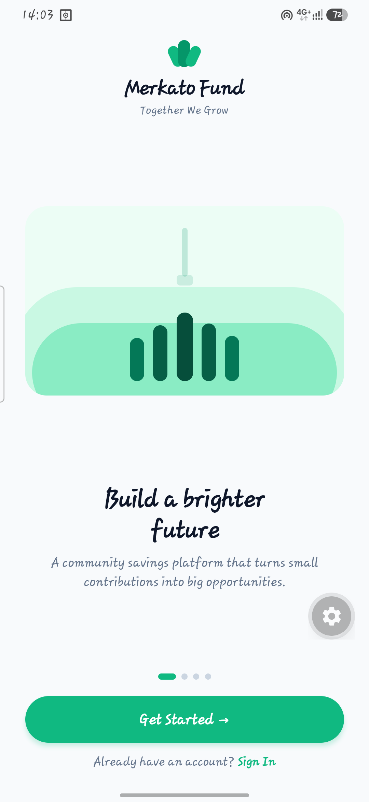 | 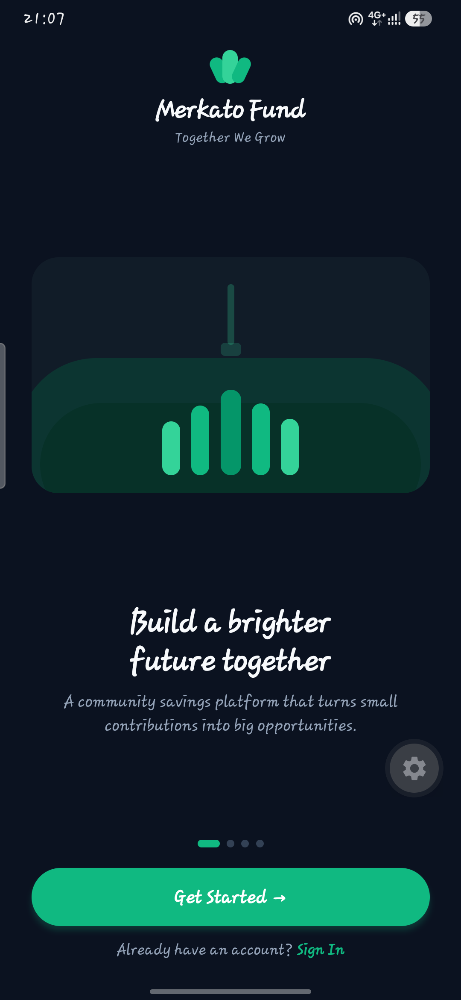 |
| **Persona Selection** | 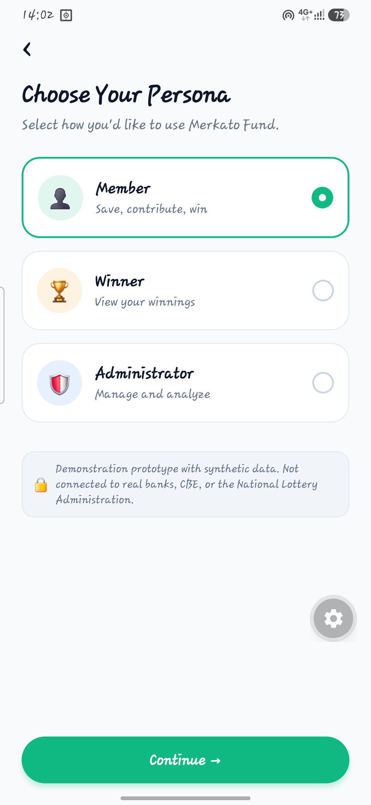 | 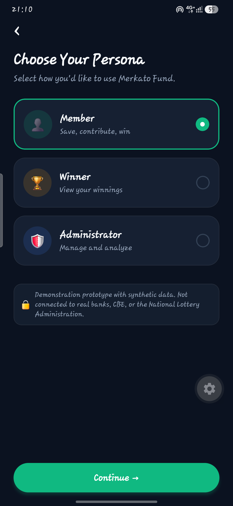 |
| **Member Dashboard** | 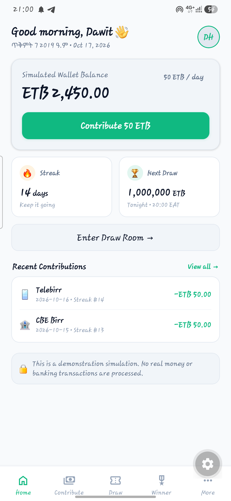 | 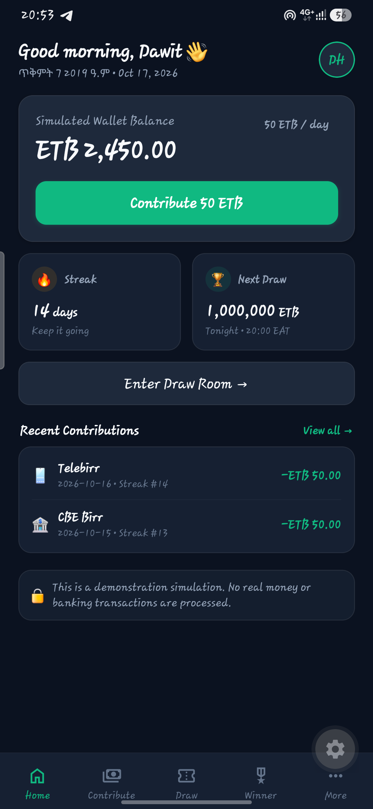 |
| **Daily 50 ETB Contribution** | 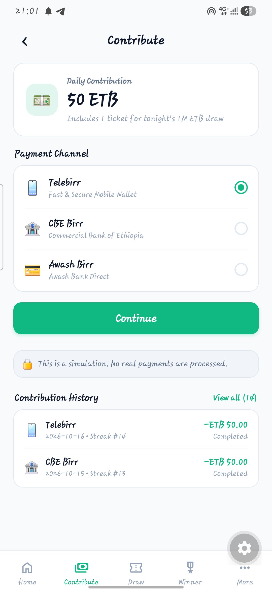 | 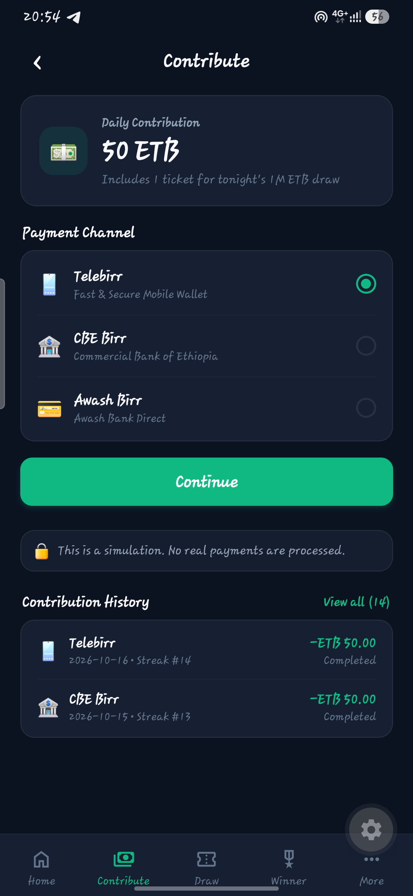 |
| **Algorithmic Draw Room** | 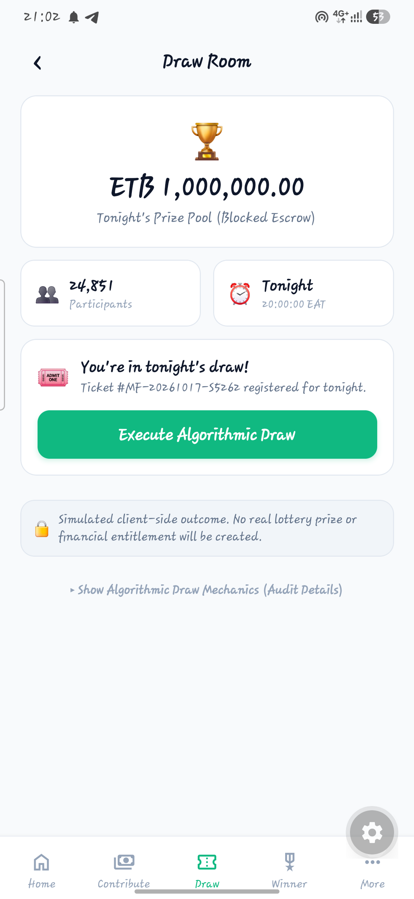 | 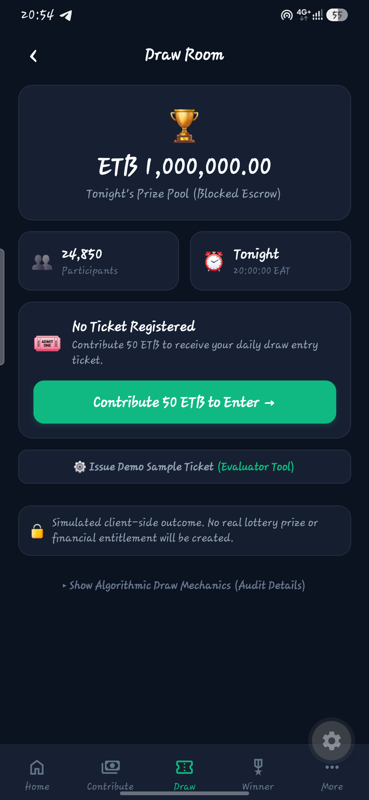 |
| **1M ETB Escrow & Winner Hub** | 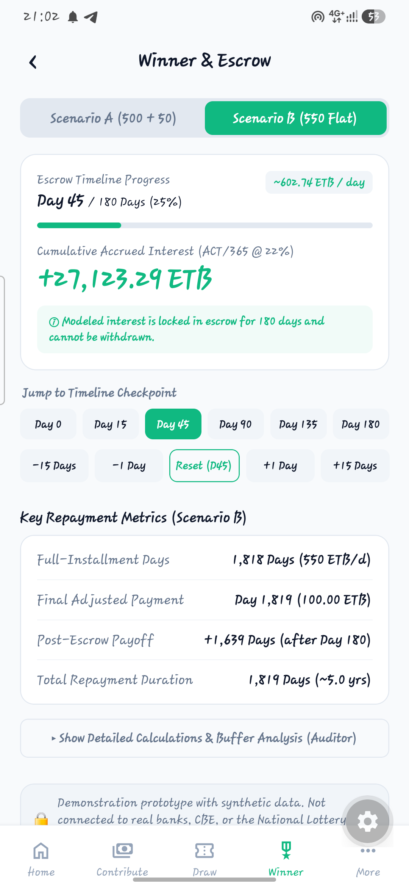 | 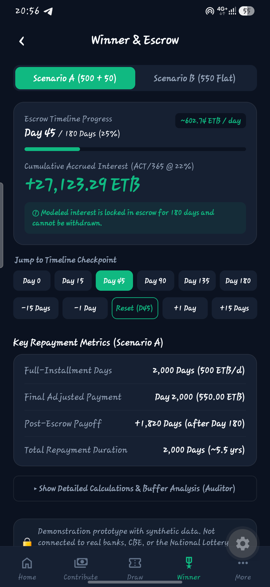 |
| **More & Settings** | 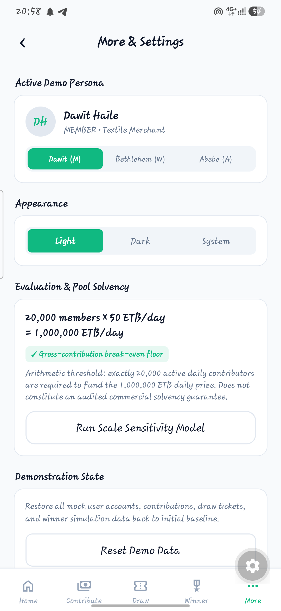 | 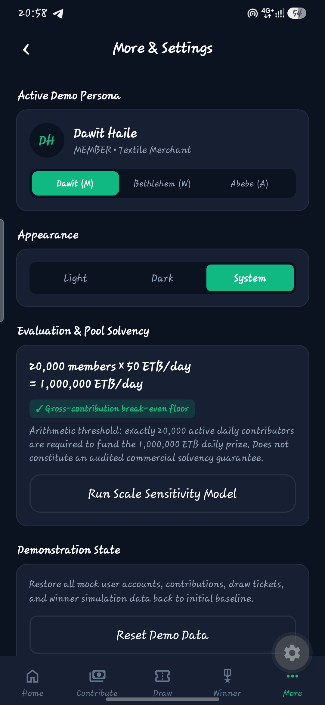 |

---

## 🚀 Do I Need to Host the App?

### **No hosting is required!**
Merkato Fund is built with a **100% self-contained, offline-first architecture**:
- **Zero Backend Servers**: No external databases, API servers, or cloud subscriptions to pay for or deploy.
- **Pure Local Calculation Engines**: ACT/365 interest arithmetic, loan amortization, buffer burn rates, deterministic 32-bit FNV-1a hash draws, and Ethiopian calendar conversion run directly in client TypeScript.
- **Local Reactive Stores**: Zustand state stores persist demo progress locally on the device.
- **Works Anywhere**: The app works fully offline without an internet connection after downloading the APK.

---

## 📦 How to Install and Run

### Option 1: Direct Android APK Build (Recommended)
You can generate a standalone `.apk` directly via Expo Application Services (EAS):

```bash
# 1. Install EAS CLI globally
npm install -g eas-cli

# 2. Login to your free Expo account
eas login

# 3. Build standalone Android APK
eas build -p android --profile preview
```
Once the build completes (typically 3–5 minutes), EAS generates a download link for your standalone `.apk` file that installs directly onto any Android phone.

### Option 2: Run Locally via Expo
```bash
# 1. Clone repository
git clone https://github.com/mihretu-dev/Merkato-Fund-App.git
cd Merkato-Fund-App

# 2. Install dependencies
npm install

# 3. Run automated tests (88 test cases)
npm test

# 4. Check TypeScript types
npm run typecheck

# 5. Launch Expo development server
npm start
```
- Press `a` in the terminal to launch on connected Android phone or emulator.
- Press `w` to launch in web browser.

---

## 🌟 Key Features

1. **Dual Calendar Engine (Ethiopian & Gregorian)**:
   - Built-in JDN (Julian Day Number) astronomical date calculation engine.
   - Amharic mode displays authentic Ethiopian calendar dates (e.g. `እሑድ፣ ጥቅምት 15፣ 2019`).
   - English mode displays Gregorian calendar dates (e.g. `Sunday, Oct 25, 2026`).

2. **Time-Based Dynamic Greeting**:
   - Automatically adapts based on device time:
     - Morning: `"Good morning,"` / `"እንደምን አደሩ፣"`
     - Afternoon: `"Good afternoon,"` / `"እንደምን ዋሉ፣"`
     - Evening: `"Good evening,"` / `"እንደምን አመሹ፣"`

3. **Total Amharic (አማርኛ) Localization**:
   - Comprehensive translations across all screens, tabs, modals, numbers, and system notifications.
   - Dynamic language switcher with instant UI re-render without app restart.

4. **Official Emblem & Brand Modals**:
   - Clickable gold Merkato Fund emblem on Onboarding and Home screen opening the **Merkato Fund Profile** modal.
   - Interactive high-resolution viewer for **The Merkato Manifesto** (`manifesto.png`) and **The Paradigm Shift: Get-to-Pay vs Pay-to-Get** (`old_vs_new.png`).

5. **Theme Switching**:
   - Polished Light, Dark, and System modes with accessible contrast ratios.
   - Quick one-tap theme toggle available directly in the Onboarding header and Settings tab.

6. **Interactive Notifications Center**:
   - Real-time synthetic notifications for tickets, pool yields, repayments, and draw alerts.
   - Dismissible items with synchronous unread counter and active bell dot indicator.

7. **Predefined Ethiopian Personas**:
   - **Dawit Haile (`member`)**: Daily micro-contributor with active 14-day streak.
   - **Bethlehem Tadesse (`winner`)**: 6-month blocked escrow winner with 1,000,000 ETB earning 22% annual yield.
   - **Abebe Kebede (`admin`)**: Pool solvency auditor testing the 20,000-member break-even floor.

---

## 📊 Core Financial Mechanics Evaluated

- **22% Escrow Yield**: Simple interest calculated using the **ACT/365** day-count convention (`1,000,000 × 0.22 / 365 = ~602.74 ETB/day`).
- **Locked Escrow Yield**: Accrued interest remains blocked in escrow custody during the 180-day lock period and cannot be drawn down as daily disposable cash.
- **15-Day Buffer Cash Deficit**: The initial 7,500 ETB buffer guarantees repayment continuity for 15 days (at 500 ETB/day).
- **Administrative Fee Separation**: The 50 ETB daily administrative fee covers operations and does **not** amortize the 1,000,000 ETB principal debt.
- **Scale Floor Breakeven**: Exactly 20,000 members contributing 50 ETB daily are required to fund the 1,000,000 ETB daily payout.

---

## 🛠️ Tech Stack & Architecture

- **Framework**: Expo SDK 58 (Expo Router 58, React Native 0.88, React 19)
- **Language**: TypeScript (`strict: true`)
- **State Management**: Zustand lightweight reactive stores
- **Styling**: Vanilla React Native `StyleSheet` with structured design tokens (`src/theme/tokens.ts`)
- **Testing**: Node.js test runner (`node:test`, `node:assert/strict`) with `tsx` (88 unit tests across 23 suites)

---

## 📄 License

This prototype is licensed under the [MIT License](LICENSE).
