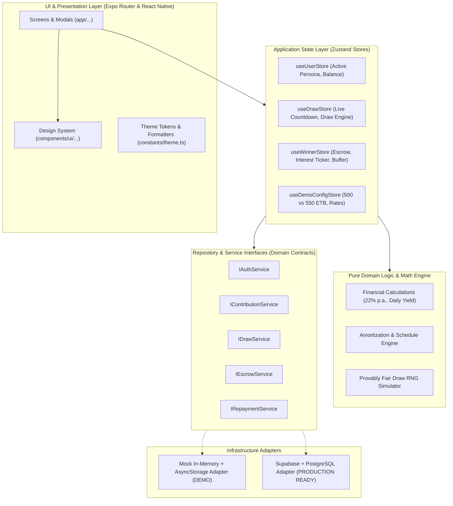

# Merkato Fund — Technical Architecture & System Design

**Project**: Merkato Fund Mobile Application  
**Target Platform**: Android & iOS (Cross-Platform via React Native & Expo)  
**Language / Framework**: TypeScript, Expo SDK 52, Expo Router (File-based Routing)  
**Author**: Senior Mobile Architect & Product Engineer  
**Date**: October 2026  

---

## 1. Architecture Overview & Principles

Merkato Fund requires a robust mobile client that can immediately demonstrate complex financial concepts (daily micro-contributions, algorithmic draw simulations, blocked bank escrow accounts, and yield-amortization schedules) while maintaining a strict boundary between demo mock implementations and a future production backend powered by **Supabase (PostgreSQL + PostgREST + Auth + Realtime)**.

### Architectural Core Principles
1. **Ports and Adapters (Hexagonal / Clean Architecture)**:
   All domain logic and UI components interact exclusively with **abstract service and repository interfaces**. For the 7-day demo, an **In-Memory & AsyncStorage Mock Adapter** fulfills these interfaces. When transitioning to production, a **Supabase Adapter** can be plugged in without rewriting a single screen or component.
2. **Deterministic Financial Math Engine**:
   All daily interest calculations ($22\% \text{ p.a.}$), buffer depletion cycles, and amortization schedules reside in pure, testable domain utilities independent of the UI layer.
3. **No Hidden State / Zero-Magic Demo Switching**:
   Demo evaluators must be able to switch between user personas (New Contributor, Active Winner, Administrator) with a single tap, without clearing storage or re-registering.
4. **Resilient Offline-First UX**:
   Optimistic UI updates with instant local feedback, graceful loading spinners, informative empty states, and explicit error recovery.
5. **Culturally Grounded Ethiopian Fintech UI**:
   Clean, institutional typography and color palette inspired by modern Ethiopian financial services (Telebirr, CBE Birr, Awash Bank), prioritizing high contrast, ETB currency semantics, and i18n readiness for Amharic.

---

## 2. Technology Stack & Evaluation

| Layer | Selected Technology | Version / Tooling | Rationale & Tradeoff Analysis |
|---|---|---|---|
| **Runtime & Framework** | **React Native + Expo** | Expo SDK 52+ | Allows rapid cross-platform development for Android and iOS from a single TypeScript codebase. Managed workflow eliminates native build toolchain friction. |
| **Language** | **TypeScript** | TypeScript 5.3+ (Strict Mode) | Strong typing prevents runtime errors in financial calculations, entity models, and navigation parameters. |
| **Routing / Navigation** | **Expo Router** | v4 (File-based routing) | Deep linking out-of-the-box, type-safe route parameters, automatic stack and tab navigation matching native conventions. |
| **State Management** | **Zustand** + React Context | Zustand 5.x | Minimal boilerplate, zero-wrapper hooks, lightweight footprint, seamless persistence adapter for local storage. |
| **Local Persistence** | **AsyncStorage** | `@react-native-async-storage/async-storage` | Simple, reliable, zero-native-build-complexity key-value store for saving demo state and user profiles. |
| **UI Styling** | **Vanilla React Native `StyleSheet` + Design Tokens** | Custom Theme Engine | Zero external CSS runtime overhead, 100% predictable cross-platform layout performance, easy dark/light mode tokenization. Avoids heavy styling libraries. |
| **Icons** | **@expo/vector-icons** | Lucide / Ionicons | Standard Expo inclusion, crisp vector rendering across all pixel densities. |
| **Testing** | **Jest + React Native Testing Library** | Latest compatible | Unit test suite for 22% interest, daily amortization, buffer countdown, and repository contracts. |
| **Future Backend Target** | **Supabase (PostgreSQL)** | Ready for `@supabase/supabase-js` | Relational integrity for user ledgers, row-level security (RLS), real-time draw events, and instant auth. |

---

## 3. High-Level System Architecture Diagram



---

## 4. Proposed Directory & File Structure

```
merkato-fund-app/
├── app/                                # Expo Router file-based routes
│   ├── _layout.tsx                     # Root layout (Theme provider, StatusBar, Font loading)
│   ├── index.tsx                       # Initial redirect / Splash logic
│   ├── (auth)/                         # Authentication & Onboarding
│   │   ├── onboarding.tsx              # 3-step value prop & Equb explanation
│   │   ├── sign-in.tsx                 # Phone sign-in + 1-Tap Demo Persona Switcher
│   ├── (tabs)/                         # Main authenticated tab navigator
│   │   ├── _layout.tsx                 # Tab navigation config (Bottom tabs)
│   │   ├── index.tsx                   # Member Dashboard (Streak, Next Draw, Balance)
│   │   ├── contribute.tsx              # Daily 50 ETB Contribution Flow & History
│   │   ├── draw.tsx                    # Algorithmic Draw Live Screen & Winner Board
│   │   ├── winner.tsx                  # 6-Month Blocked Escrow, 22% Interest & Buffer
│   │   └── profile.tsx                 # User Profile, Demo Switcher & Settings
│   ├── modals/                         # Modals and transient flows
│   │   ├── payment-checkout.tsx        # Simulated Telebirr / CBE payment modal
│   │   ├── draw-result.tsx             # Interactive Winner Celebration Modal
│   │   ├── repayment-breakdown.tsx     # Transparent 500 vs 550 ETB breakdown
│   │   └── buffer-replenish.tsx        # 7,500 ETB buffer management modal
│   └── admin/                          # Feasible Admin Preview (Separated permissions)
│       ├── _layout.tsx
│       └── index.tsx                   # Pool statistics, manual draw trigger, audit log
├── src/
│   ├── components/                     # Reusable UI component library
│   │   ├── ui/
│   │   │   ├── Button.tsx              # Primary, secondary, outline, loading states
│   │   │   ├── Card.tsx                # Elevated surface, glassmorphism card
│   │   │   ├── Badge.tsx               # Status badges (Verified, Winner, Demo)
│   │   │   ├── MetricTile.tsx          # Financial metric display (ETB balance, ticker)
│   │   │   ├── TimelineView.tsx        # 6-month visual milestone tracker
│   │   │   ├── ProgressBar.tsx         # Goal progress & buffer depletion bar
│   │   │   ├── Header.tsx              # Screen header with Ethiopian branding & demo tag
│   │   │   ├── EmptyState.tsx          # Friendly empty states for lists
│   │   │   └── DemoWatermark.tsx       # Persistent unobtrusive "Demo Mode" indicator
│   │   ├── domain/
│   │   │   ├── ContributionStreak.tsx  # Calendar streak visualizer
│   │   │   ├── EscrowTicker.tsx        # Real-time ticking 22% interest counter
│   │   │   └── BufferStatusCard.tsx    # 15-day / 7,500 ETB buffer monitor
│   ├── domain/                         # Pure domain models and calculations
│   │   ├── types.ts                    # All TypeScript types and interfaces
│   │   ├── calculations/
│   │   │   ├── interest.ts             # 22% p.a. daily compound & simple interest
│   │   │   ├── amortization.ts         # 500/550 ETB schedule projection
│   │   │   └── draw-algorithm.ts       # Deterministic PRNG draw simulator
│   ├── services/                       # Repository interfaces & mock adapters
│   │   ├── interfaces/
│   │   │   ├── IAuthService.ts
│   │   │   ├── IContributionService.ts
│   │   │   ├── IDrawService.ts
│   │   │   ├── IEscrowService.ts
│   │   │   └── IRepaymentService.ts
│   │   ├── mock/                       # In-memory mock implementations
│   │   │   ├── mockData.ts             # Seed data with realistic Ethiopian names/dates
│   │   │   ├── MockAuthService.ts
│   │   │   ├── MockContributionService.ts
│   │   │   ├── MockDrawService.ts
│   │   │   ├── MockEscrowService.ts
│   │   │   └── MockRepaymentService.ts
│   │   └── ServiceFactory.ts           # Dependency injection container
│   ├── stores/                         # Zustand state stores
│   │   ├── useUserStore.ts
│   │   ├── useContributionStore.ts
│   │   ├── useDrawStore.ts
│   │   ├── useWinnerStore.ts
│   │   └── useDemoConfigStore.ts
│   ├── theme/                          # Design tokens and aesthetics
│   │   ├── colors.ts                   # Emerald green, deep slate, gold accents
│   │   ├── typography.ts               # Font sizes, line heights, weights
│   │   ├── spacing.ts                  # 4px/8px grid system
│   │   └── formatters.ts               # ETB currency, Ethiopian date formatting
│   └── utils/
│       ├── test-helpers.ts             # Test runner setup and mock fixtures
│       └── validation.ts               # Input validation for phone & amounts
├── docs/                               # Architecture and planning documentation
│   ├── requirements.md
│   ├── architecture.md
│   ├── data-model.md
│   ├── implementation-plan.md
│   └── open-questions.md
├── tests/                              # Automated tests
│   ├── calculations.test.ts            # Interest, amortization, buffer calculations
│   ├── draw-algorithm.test.ts          # Provably fair RNG properties
│   └── mock-services.test.ts           # Mock service contract adherence
├── app.json                            # Expo app configuration
├── package.json                        # Dependencies
└── tsconfig.json                       # TypeScript configuration
```

---

## 5. Screen Map & Navigation Hierarchy

```mermaid
graph TD
    Entry([App Launch: app/index.tsx]) --> AuthCheck{Is Profile Selected?}
    
    AuthCheck -- No --> Onboarding[app/(auth)/onboarding.tsx]
    Onboarding --> SignIn[app/(auth)/sign-in.tsx]
    SignIn -- Select Persona --> Dashboard
    
    AuthCheck -- Yes --> Dashboard[app/(tabs)/index.tsx - Dashboard]
    
    subgraph TabNavigator["Main Tab Navigation: app/(tabs)/"]
        Dashboard --> Tab1[Dashboard: Daily Streak, Balance, Next Draw Widget]
        Tab1 --> Tab2[Contribute: 50 ETB Daily Payment, Payment History]
        Tab2 --> Tab3[Draw: Daily Live Draw Room, History, Tickets]
        Tab3 --> Tab4[Winner: 1M ETB Escrow, 22% Interest Ticker, Buffer]
        Tab4 --> Tab5[Profile: Persona Switcher, Demo Config, Settings]
    end

    Tab2 --> PaymentModal([app/modals/payment-checkout.tsx])
    Tab3 --> DrawResultModal([app/modals/draw-result.tsx])
    Tab4 --> BreakdownModal([app/modals/repayment-breakdown.tsx])
    Tab4 --> BufferModal([app/modals/buffer-replenish.tsx])
    
    Tab5 -- If Admin Mode --> AdminScreen[app/admin/index.tsx - Pool Ledger & Draw Controls]
```

---

## 6. Service Boundaries & Interface Contracts

Every service is defined by a clean TypeScript interface to ensure strict separation of concerns and enable a painless transition to Supabase.

### 6.1 `IAuthService`
```typescript
export interface IAuthService {
  getCurrentUser(): Promise<User>;
  switchDemoPersona(personaId: 'new_contributor' | 'active_winner' | 'admin'): Promise<User>;
  signOut(): Promise<void>;
}
```

### 6.2 `IContributionService`
```typescript
export interface IContributionService {
  getContributionStatus(userId: string): Promise<ContributionStatus>;
  submitDailyContribution(userId: string, paymentMethod: PaymentMethod): Promise<ContributionRecord>;
  getContributionHistory(userId: string, limit?: number): Promise<ContributionRecord[]>;
}
```

### 6.3 `IDrawService`
```typescript
export interface IDrawService {
  getUpcomingDraw(): Promise<DailyDraw>;
  getUserTickets(userId: string, drawId: string): Promise<DrawTicket[]>;
  executeSimulatedDraw(drawId: string): Promise<DailyDrawResult>;
  getPastDraws(limit?: number): Promise<DailyDrawResult[]>;
}
```

### 6.4 `IEscrowService` & `IRepaymentService`
```typescript
export interface IEscrowService {
  getWinnerEscrow(userId: string): Promise<EscrowAccount>;
  getInterestAccrualSummary(escrowId: string): Promise<InterestAccrualSummary>;
}

export interface IRepaymentService {
  getRepaymentSchedule(winnerId: string): Promise<RepaymentSchedule>;
  getBufferStatus(winnerId: string): Promise<WinnerBufferStatus>;
  submitRepayment(winnerId: string, amount: number): Promise<RepaymentTransaction>;
  replenishBuffer(winnerId: string, amount: number): Promise<WinnerBufferStatus>;
}
```

---

## 7. State Management & Data Flow Architecture

We use **Zustand** stores with modular domains:
1. `useUserStore`: Handles active user profile, switching demo personas, and basic session details.
2. `useContributionStore`: Tracks the user's daily payment status (e.g. `paid_today: boolean`), current streak, and history.
3. `useDrawStore`: Manages the simulated countdown timer, active ticket, and draw execution state.
4. `useWinnerStore`: Holds the active winner's escrow state, live ticking interest ($602.74/day converted to per-second fractional ticks for visual delight), and 15-day buffer countdown.
5. `useDemoConfigStore`: Global sandbox settings (e.g., toggling between 500 ETB vs 550 ETB repayment models, tweaking the 22% rate to simulate economic shifts).

---

## 8. Ethiopian Fintech Design System & Tokens

To deliver an authentically premium Ethiopian fintech aesthetic (moving far beyond generic boilerplate templates):

### 8.1 Color Palette
- **Primary / Heritage Emerald**: `#0D5C3A` (Evoking Ethiopian prosperity, agricultural heritage, and financial stability).
- **Secondary / Deep Slate**: `#0B131F` (Premium dark banking tone).
- **Accent / Merkato Gold**: `#D4AF37` / `#F59E0B` (Value, capital prize, golden key).
- **Surface & Backgrounds**:
  - Light Background: `#F8FAFC`
  - Card Surface: `#FFFFFF`
  - Subtle Border: `#E2E8F0`
- **Semantic Feedback**:
  - Success: `#10B981` (CBE / Telebirr confirmation green)
  - Warning: `#F59E0B` (Buffer replenishment alert)
  - Danger: `#EF4444` (Default / Missed contribution)
  - Info / Escrow: `#3B82F6` (Blocked bank lock tone)

### 8.2 Currency & Date Formatting
- All currency amounts use standard Ethiopian formatting:
  - `ETB 1,000,000.00` or `50 ETB`
- Date formatting accounts for both Western calendar and placeholders for the Ethiopian Ge'ez calendar (e.g., Tikimt / Meskerem in future iterations).

### 8.3 Touch Targets & Accessibility
- Minimum touch target: **$48 \times 48 \text{ dp}$**.
- High contrast typography adhering to **WCAG AA standards**.
- Dynamic screen sizing adapting smoothly to iPhone SE, standard devices, and Android phablets.

---

## 9. Testing Strategy

1. **Unit Testing Pure Math Functions**:
   - Accrual of $22\%$ on 1,000,000 ETB over 180 days.
   - Exact daily simple interest ($220,000 / 365 = 602.7397$ ETB).
   - Comparison of 500 ETB/day vs 550 ETB/day amortization schedules.
   - Buffer depletion ($7,500 \text{ ETB} - (500 \times N \text{ days})$).
2. **Mock Service Contract Tests**:
   - Verify that all mock methods return strictly typed data matching `domain/types.ts`.
3. **Component & State Integration Tests**:
   - Verify that switching demo personas dynamically updates the dashboard, winner escrow, and tab accessibility without errors.
