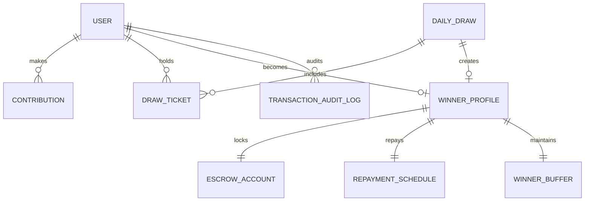

# Merkato Fund — Data Model & Schema Specification

**Project**: Merkato Fund Mobile Application  
**Document**: Data Model, TypeScript Interfaces, & PostgreSQL/Supabase Schema Blueprint  
**Author**: Senior Mobile Architect & Product Engineer  
**Date**: October 2026  

---

## 1. Domain Entities & Relationships

The Merkato Fund data model captures the four foundational pillars described in the product vision:
1. **Community Savings (Equb)**: Daily micro-contributions, streaks, and member profiles.
2. **Algorithmic Selection (Lottery)**: Daily draw events, provably fair seeds, and participant tickets.
3. **Escrow Custody (Banking)**: 6-month blocked bank accounts, $22\%$ annualized interest accrual, and milestone tracking.
4. **Structured Repayment (Capital Markets)**: Escalated daily repayments ($500 \text{ ETB} + 50 \text{ ETB}$), 15-day $7,500 \text{ ETB}$ buffer management, and interest offset tracking.



---

## 2. TypeScript Domain Definitions (`src/domain/types.ts`)

```typescript
/**
 * User Roles & Personas supported in the application
 */
export type UserRole = 'member' | 'winner' | 'admin';

export type PaymentChannel = 'telebirr' | 'cbe_birr' | 'awash_birr' | 'amole' | 'bank_transfer';

export interface User {
  id: string;
  phoneNumber: string;
  fullName: string;
  role: UserRole;
  avatarUrl?: string;
  joinedDate: string; // ISO-8601
  isVerified: boolean;
  activeStreakDays: number;
  totalContributedETB: number;
  simulatedBalanceETB: number; // For demo checkout funding
}

/**
 * Daily 50 ETB Micro-Contribution
 */
export type ContributionStatus = 'completed' | 'pending' | 'failed';

export interface Contribution {
  id: string;
  userId: string;
  amountETB: number; // Standard: 50 ETB
  date: string; // YYYY-MM-DD
  timestamp: string; // ISO-8601
  channel: PaymentChannel;
  transactionReference: string;
  status: ContributionStatus;
  streakDay: number;
  isSimulated: true;
}

/**
 * Daily Algorithmic Draw
 */
export type DrawStatus = 'scheduled' | 'in_progress' | 'completed' | 'cancelled';

export interface DailyDraw {
  id: string;
  drawDate: string; // YYYY-MM-DD
  scheduledTime: string; // e.g., "20:00:00 EAT"
  prizeAmountETB: number; // Stated: 1,000,000 ETB
  status: DrawStatus;
  participantCount: number;
  poolTotalCollectedETB: number;
  hashSeed: string; // SHA-256 seed for transparency
  winningTicketNumber?: string;
  winnerUserId?: string;
  winnerName?: string;
  completedAt?: string;
}

export interface DrawTicket {
  id: string;
  drawId: string;
  userId: string;
  ticketNumber: string; // e.g. "MF-20261016-8492"
  issuedAt: string;
  isWinningTicket: boolean;
}

/**
 * 6-Month Blocked Bank Escrow Account
 */
export type EscrowStatus = 'locked' | 'maturing' | 'unlocked' | 'disbursed';

export interface EscrowAccount {
  id: string;
  winnerId: string;
  userId: string;
  principalAmountETB: number; // 1,000,000 ETB
  annualInterestRate: number; // 0.22 (22%)
  lockedDate: string; // ISO-8601
  unlockDate: string; // ISO-8601 (+180 days)
  status: EscrowStatus;
  bankPartner: 'Commercial Bank of Ethiopia (CBE)' | 'Dashen Bank' | 'Awash Bank';
  escrowAccountNumber: string; // Simulated account e.g. "1000-ESC-8392-ETB"
  totalDaysLocked: number; // 180 days
  elapsedDays: number;
  dailyInterestYieldETB: number; // Principal * 0.22 / 365 = 602.74 ETB
  accruedInterestETB: number; // Elapsed * dailyInterestYieldETB
  projectedTotalInterestETB: number; // 180 * 602.74 = ~108,493.15 ETB
}

/**
 * Post-Win Repayment Schedule
 */
export interface RepaymentSchedule {
  id: string;
  winnerId: string;
  userId: string;
  totalPrizeETB: number; // 1,000,000 ETB
  dailyPrincipalETB: number; // 500 ETB
  dailyAdminFeeETB: number; // 50 ETB
  dailyTotalDueETB: number; // 550 ETB
  monthlyProjectedETB: number; // 16,500 ETB (or 15,000 ETB if admin fee excluded)
  totalRepaidETB: number;
  remainingPrincipalETB: number;
  interestOffsetAppliedETB: number;
  netOutOfPocketRepaidETB: number;
  installmentsCompleted: number;
  totalInstallmentsExpected: number; // ~2,000 days for 1M principal at 500/day
  currentStreakDays: number;
  nextPaymentDueDate: string;
}

export interface RepaymentInstallment {
  id: string;
  scheduleId: string;
  installmentNumber: number;
  dueDate: string;
  principalAmountETB: number; // 500 ETB
  adminFeeETB: number; // 50 ETB
  interestCreditOffsetETB: number; // Deducted from 22% bank yield
  netPaidByWinnerETB: number;
  status: 'paid' | 'due' | 'overdue';
  paidAt?: string;
  paymentChannel: PaymentChannel;
}

/**
 * Winner Operational Buffer (7,500 ETB / 15-day cycle)
 */
export type BufferHealthStatus = 'healthy' | 'caution' | 'critical' | 'depleted';

export interface WinnerBuffer {
  id: string;
  winnerId: string;
  cycleLengthDays: number; // 15 days
  targetBufferAmountETB: number; // 7,500 ETB
  currentBufferBalanceETB: number;
  dailyBurnRateETB: number; // 500 ETB / day
  cycleStartDate: string;
  cycleRenewalDate: string; // cycleStartDate + 15 days
  daysRemainingInCycle: number;
  healthStatus: BufferHealthStatus;
  autoReplenishEnabled: boolean;
  lastReplenishedDate?: string;
}

/**
 * System Notifications
 */
export type NotificationType = 'draw_result' | 'contribution_reminder' | 'buffer_warning' | 'interest_accrual' | 'system';

export interface AppNotification {
  id: string;
  userId: string;
  title: string;
  message: string;
  type: NotificationType;
  timestamp: string;
  isRead: boolean;
  actionRoute?: string;
}

/**
 * Configurable Demo Assumptions & Sandbox Controls
 */
export interface DemoConfiguration {
  repaymentDailyModel: '500_plus_50' | '550_bundle' | '500_only';
  annualInterestRate: number; // Default 0.22
  bufferAmountETB: number; // Default 7500
  bufferCycleDays: number; // Default 15
  dailyContributionETB: number; // Default 50
  prizeAmountETB: number; // Default 1,000,000
  simulatedDrawCountdownSeconds: number; // Acceleration for testing
}
```

---

## 3. Relational Schema Blueprint (PostgreSQL / Supabase DDL)

This SQL blueprint guarantees that our domain model directly translates into a secure, production-ready PostgreSQL relational database on Supabase when the backend is commissioned.

```sql
-- MERKATO FUND RELATIONAL SCHEMA (SUPABASE / POSTGRESQL)

-- 1. Users / Profiles table (extends Supabase auth.users)
CREATE TABLE public.profiles (
    id UUID PRIMARY KEY REFERENCES auth.users(id) ON DELETE CASCADE,
    phone_number VARCHAR(20) NOT NULL UNIQUE,
    full_name VARCHAR(100) NOT NULL,
    role VARCHAR(20) NOT NULL DEFAULT 'member' CHECK (role IN ('member', 'winner', 'admin')),
    avatar_url TEXT,
    is_verified BOOLEAN DEFAULT FALSE,
    active_streak_days INT DEFAULT 0,
    total_contributed_etb NUMERIC(12,2) DEFAULT 0.00,
    created_at TIMESTAMPTZ DEFAULT NOW(),
    updated_at TIMESTAMPTZ DEFAULT NOW()
);

-- 2. Daily Contributions (50 ETB Ledger)
CREATE TABLE public.contributions (
    id UUID PRIMARY KEY DEFAULT gen_random_uuid(),
    user_id UUID NOT NULL REFERENCES public.profiles(id) ON DELETE RESTRICT,
    amount_etb NUMERIC(10,2) NOT NULL DEFAULT 50.00,
    contribution_date DATE NOT NULL DEFAULT CURRENT_DATE,
    channel VARCHAR(30) NOT NULL CHECK (channel IN ('telebirr', 'cbe_birr', 'awash_birr', 'amole', 'bank_transfer')),
    transaction_ref VARCHAR(64) NOT NULL UNIQUE,
    status VARCHAR(20) NOT NULL DEFAULT 'completed' CHECK (status IN ('completed', 'pending', 'failed')),
    streak_day INT NOT NULL,
    is_simulated BOOLEAN DEFAULT TRUE,
    created_at TIMESTAMPTZ DEFAULT NOW(),
    CONSTRAINT unique_user_daily_contribution UNIQUE (user_id, contribution_date)
);

-- 3. Daily Draws
CREATE TABLE public.daily_draws (
    id UUID PRIMARY KEY DEFAULT gen_random_uuid(),
    draw_date DATE NOT NULL UNIQUE DEFAULT CURRENT_DATE,
    prize_amount_etb NUMERIC(12,2) NOT NULL DEFAULT 1000000.00,
    status VARCHAR(20) NOT NULL DEFAULT 'scheduled' CHECK (status IN ('scheduled', 'in_progress', 'completed', 'cancelled')),
    participant_count INT DEFAULT 0,
    pool_total_collected_etb NUMERIC(12,2) DEFAULT 0.00,
    hash_seed VARCHAR(64) NOT NULL,
    winning_ticket_number VARCHAR(32),
    winner_user_id UUID REFERENCES public.profiles(id),
    scheduled_time TIMESTAMPTZ NOT NULL,
    completed_at TIMESTAMPTZ
);

-- 4. Draw Tickets
CREATE TABLE public.draw_tickets (
    id UUID PRIMARY KEY DEFAULT gen_random_uuid(),
    draw_id UUID NOT NULL REFERENCES public.daily_draws(id) ON DELETE CASCADE,
    user_id UUID NOT NULL REFERENCES public.profiles(id) ON DELETE CASCADE,
    ticket_number VARCHAR(32) NOT NULL UNIQUE,
    is_winning_ticket BOOLEAN DEFAULT FALSE,
    issued_at TIMESTAMPTZ DEFAULT NOW()
);

-- 5. Winner Escrow Accounts (6-Month Blocked Bank Account)
CREATE TABLE public.escrow_accounts (
    id UUID PRIMARY KEY DEFAULT gen_random_uuid(),
    winner_user_id UUID NOT NULL REFERENCES public.profiles(id) ON DELETE RESTRICT,
    principal_amount_etb NUMERIC(12,2) NOT NULL DEFAULT 1000000.00,
    annual_interest_rate NUMERIC(5,4) NOT NULL DEFAULT 0.2200, -- 22%
    locked_date TIMESTAMPTZ NOT NULL DEFAULT NOW(),
    unlock_date TIMESTAMPTZ NOT NULL DEFAULT (NOW() + INTERVAL '180 days'),
    status VARCHAR(20) NOT NULL DEFAULT 'locked' CHECK (status IN ('locked', 'maturing', 'unlocked', 'disbursed')),
    bank_partner VARCHAR(80) NOT NULL DEFAULT 'Commercial Bank of Ethiopia (CBE)',
    escrow_account_number VARCHAR(40) NOT NULL,
    created_at TIMESTAMPTZ DEFAULT NOW()
);

-- 6. Repayment Schedules
CREATE TABLE public.repayment_schedules (
    id UUID PRIMARY KEY DEFAULT gen_random_uuid(),
    winner_user_id UUID NOT NULL REFERENCES public.profiles(id) ON DELETE RESTRICT,
    total_prize_etb NUMERIC(12,2) NOT NULL DEFAULT 1000000.00,
    daily_principal_etb NUMERIC(10,2) NOT NULL DEFAULT 500.00,
    daily_admin_fee_etb NUMERIC(10,2) NOT NULL DEFAULT 50.00,
    remaining_principal_etb NUMERIC(12,2) NOT NULL DEFAULT 1000000.00,
    installments_completed INT DEFAULT 0,
    next_payment_due_date DATE NOT NULL,
    created_at TIMESTAMPTZ DEFAULT NOW()
);

-- 7. Winner Buffers (7,500 ETB / 15-day cycle)
CREATE TABLE public.winner_buffers (
    id UUID PRIMARY KEY DEFAULT gen_random_uuid(),
    winner_user_id UUID NOT NULL REFERENCES public.profiles(id) ON DELETE RESTRICT,
    cycle_length_days INT NOT NULL DEFAULT 15,
    target_buffer_amount_etb NUMERIC(10,2) NOT NULL DEFAULT 7500.00,
    current_buffer_balance_etb NUMERIC(10,2) NOT NULL DEFAULT 7500.00,
    cycle_start_date DATE NOT NULL DEFAULT CURRENT_DATE,
    cycle_renewal_date DATE NOT NULL DEFAULT (CURRENT_DATE + INTERVAL '15 days'),
    auto_replenish_enabled BOOLEAN DEFAULT TRUE,
    created_at TIMESTAMPTZ DEFAULT NOW()
);

-- Row Level Security (RLS) policies will ensure members can only view their own records,
-- while the public can view anonymized winning ticket numbers for draw transparency.
```

---

## 4. Realistic Ethiopian Demo Seed Data (`src/services/mock/mockData.ts`)

To ensure the demo feels authentically Ethiopian and reflects real-world marketplace dynamics:

### 4.1 Demo Personas
1. **Persona A: Dawit Haile (New Regular Contributor)**
   - Role: `member`
   - Phone: `+251 91 123 4567`
   - Location: Merkato Market, Addis Ababa
   - Active Streak: 14 days
   - Total Contributed: 700 ETB
   - Paid Today: Yes
   - Ticket Number: `MF-20261016-1049`
2. **Persona B: Bethlehem Tadesse (Active Winner — Month 2 of 6)**
   - Role: `winner`
   - Phone: `+251 92 888 9900`
   - Win Date: 45 days ago (Won on 2026-09-01)
   - Escrow Status: 1,000,000 ETB locked at CBE (45 / 180 days completed)
   - Accrued Interest: $\approx 27,123.30 \text{ ETB}$ ($45 \times 602.74$)
   - Repayment Status: 45 installments completed ($24,750 \text{ ETB}$ gross)
   - 15-Day Buffer: 5,000 ETB remaining out of 7,500 ETB (Next replenishment in 5 days)
3. **Persona C: Admin / Auditor (Demo Inspector)**
   - Role: `admin`
   - Pool Balance: 1,242,500 ETB
   - Active Daily Contributors: 24,850

### 4.2 Simulated Payment Methods
- **Telebirr**: Instant mobile push notification simulator.
- **CBE Birr**: Account debit simulator.
- **Awash Birr**: SMS OTP simulation.
