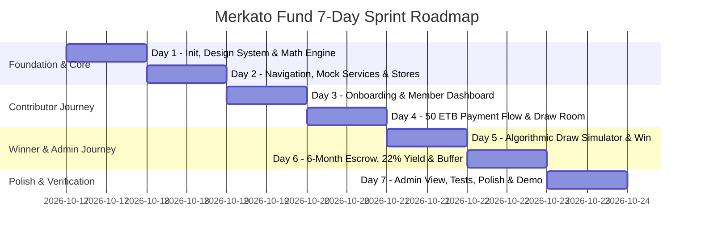

# Merkato Fund — Seven-Day Implementation Plan & Delivery Roadmap

**Project**: Merkato Fund Mobile Application  
**Target Platform**: Android & iOS (React Native + Expo SDK 52 + TypeScript)  
**Timeline**: 7 Calendar Days  
**Author**: Senior Mobile Architect & Product Engineer  
**Date**: October 2026  

---

## 1. Strategy: Small, Working End-to-End Demo Over Incomplete Breadth

In mobile fintech prototypes, an end-to-end user journey that works reliably across every touchpoint is far more compelling than a wide array of half-baked, broken screens.

### Core Guiding Tenet
> **"One complete, verifiable loop first."**  
> We prioritize a rock-solid, cohesive experience where a user can onboard, make a simulated 50 ETB daily payment via Telebirr, see their draw ticket generated, witness the live algorithmic draw countdown, and inspect the winner's 6-month escrow with real-time 22% interest ticking and buffer status.

---

## 2. Seven-Day Day-by-Day Implementation Roadmap

---

### Day 1: Project Initialization, Design Tokens & Domain Math Engine
- **Objective**: Establish the Expo project structure, TypeScript configuration, design tokens, and thoroughly tested domain calculation engines.
- **Deliverables**:
  - Initialize clean Expo project with Expo Router template.
  - Setup TypeScript `tsconfig.json` with strict type checking and path aliases (`@/*`).
  - Create design tokens in `src/theme/` (`colors.ts`, `typography.ts`, `spacing.ts`, `formatters.ts`).
  - Implement pure domain financial calculation modules:
    - `src/domain/calculations/interest.ts`: 22% p.a. simple and daily compound formula, per-second tick converter.
    - `src/domain/calculations/amortization.ts`: 500 ETB vs 550 ETB daily schedule generator, interest offset calculator.
    - `src/domain/calculations/draw-algorithm.ts`: Seeded pseudo-random draw algorithm.
  - Setup **Jest test suite** and execute automated unit tests verifying the mathematical engine.

---

### Day 2: Navigation Shell, Mock Services & State Management
- **Objective**: Build the application backbone, navigation routing, mock services, and Zustand stores.
- **Deliverables**:
  - Configure Expo Router hierarchy:
    - `app/(auth)/` stack (Onboarding, Sign-in/Persona Switcher).
    - `app/(tabs)/` bottom tab bar (Dashboard, Contribute, Draw, Winner, Profile).
    - `app/modals/` for payment, draw celebration, and repayments.
  - Implement mock repository layer (`MockAuthService`, `MockContributionService`, `MockDrawService`, `MockEscrowService`, `MockRepaymentService`).
  - Seed realistic Ethiopian data (`mockData.ts`) with 3 personas (Dawit Haile, Bethlehem Tadesse, Admin Auditor).
  - Setup Zustand stores (`useUserStore`, `useContributionStore`, `useDrawStore`, `useWinnerStore`, `useDemoConfigStore`).
  - Build foundational UI primitives: `Button`, `Card`, `Badge`, `MetricTile`, `Header`, `DemoWatermark`.

---

### Day 3: Welcome Onboarding, Persona Switcher & Member Dashboard
- **Objective**: Deliver the initial user entry flow and the primary Member Dashboard.
- **Deliverables**:
  - **Onboarding Carousel (`app/(auth)/onboarding.tsx`)**:
    - Slide 1: "Reversing Capital Flow" (Equb + Lottery + Bank + Market).
    - Slide 2: "50 Birr Daily Micro-Contribution".
    - Slide 3: "1,000,000 Birr Payout & 6-Month Self-Paying Block".
    - Clear demo disclaimer badge.
  - **Sign-In & Fast Persona Switcher (`app/(auth)/sign-in.tsx`)**:
    - 1-tap quick login for demo evaluators (Pre-win Contributor vs Active Winner vs Admin).
  - **Member Dashboard (`app/(tabs)/index.tsx`)**:
    - Ethiopian greeting and user persona pill.
    - Daily Contribution Status card (Paid today vs Due).
    - 14-Day Calendar Streak visualizer.
    - Next Algorithmic Draw Countdown live widget.
    - Quick-action buttons (Pay 50 ETB, View Tickets).

---

### Day 4: Daily 50 ETB Contribution Flow & Simulated Payment Gateway
- **Objective**: Allow users to experience the daily micro-contribution and simulated checkout.
- **Deliverables**:
  - **Contribution Screen (`app/(tabs)/contribute.tsx`)**:
    - Visual streak tracker and payment calendar.
    - Contribution ledger with historical transaction receipts.
    - Explanation banner on where the 50 ETB goes (Pool accumulation).
  - **Payment Checkout Modal (`app/modals/payment-checkout.tsx`)**:
    - Realistic simulation of Ethiopian mobile payment channels:
      - **Telebirr** (USSD push simulation).
      - **CBE Birr** (Commercial Bank of Ethiopia debit).
      - **Awash / Dashen / Amole**.
    - Simulated loading spinner, PIN entry mockup, and animated success screen.
    - Auto-generates a unique Draw Ticket for today's draw upon payment completion.

---

### Day 5: Algorithmic Draw Simulator & Interactive Winner Announcement
- **Objective**: Deliver the exciting, transparent daily draw experience.
- **Deliverables**:
  - **Draw Screen (`app/(tabs)/draw.tsx`)**:
    - Real-time countdown timer to the scheduled draw.
    - Algorithmic transparency card showing SHA-256 hash seed, total participants (e.g. 24,850), and prize pool.
    - User's active ticket display with eligibility badge.
    - "Simulate Live Draw Now" testing button for demo reviewers.
  - **Winner Celebration Modal (`app/modals/draw-result.tsx`)**:
    - Exciting Ethiopian confetti and celebratory sound/animation cue.
    - Displays winning ticket number and winner profile.
    - Direct "Transition to Winner Experience" call-to-action button.
  - **Draw History Ledger**:
    - List of previous daily draws with verified winning ticket numbers and dates.

---

### Day 6: Winner Experience (6-Month Blocked Escrow, 22% Interest & Buffer)
- **Objective**: Deliver the core financial value proposition of the 1,000,000 ETB blocked escrow.
- **Deliverables**:
  - **Winner Hub Screen (`app/(tabs)/winner.tsx`)**:
    - 1,000,000 ETB Blocked Escrow Account card (CBE escrow account badge).
    - **Live 22% Interest Accrual Ticker**:
      - Real-time ticking counter showing micro-accrual based on $602.74 \text{ ETB / day}$.
    - **6-Month Milestone Timeline (`TimelineView.tsx`)**:
      - Visual 180-day progress bar highlighting month-by-month unlocks.
  - **Repayment Schedule & Reality Inspector (`app/modals/repayment-breakdown.tsx`)**:
    - Interactive comparison between 500 ETB/day and 550 ETB/day.
    - Clear visualization of the interest offset ($602.74 \text{ interest} - 550 \text{ payment} = +52.74 \text{ ETB/day surplus}$).
  - **Winner's Operational Buffer Card (`src/components/domain/BufferStatusCard.tsx`)**:
    - 7,500 ETB buffer balance monitor.
    - 15-day replenishment countdown and simulated auto-top-up trigger.

---

### Day 7: Admin Preview, Automated Testing, Polish & Demo Handover
- **Objective**: Add optional admin view, run test suite, polish UI edge cases, and finalize deliverables.
- **Deliverables**:
  - **Administrator View (`app/admin/index.tsx`)**:
    - Pool health metrics (Total contributors, daily inflow, prize allocation).
    - Manual draw trigger and RNG audit log.
    - Role gate (only visible when Admin persona is selected).
  - **Demo Sandbox Controls**:
    - Floating / Profile Drawer allowing demo evaluators to toggle financial parameters, reset state, or accelerate draw countdowns.
  - **Automated Test Suite**:
    - Run all Jest unit tests (`calculations.test.ts`, `mock-services.test.ts`).
  - **Cross-Device UI Polish**:
    - Responsive layout verification for small and large screens.
    - Light / Dark theme contrast checks.
    - Empty states, network error simulations, and loading skeleton states.

---

## 3. Testing Strategy & Quality Assurance Matrix

| Test Level | Scope / Target | Tools | Key Assertions |
|---|---|---|---|
| **Unit Tests** | `src/domain/calculations/interest.ts` | Jest | $\frac{1,000,000 \times 0.22}{365} = 602.7397$ ETB/day. 180-day interest yield $= 108,493.15$ ETB. |
| **Unit Tests** | `src/domain/calculations/amortization.ts` | Jest | 500 ETB $\times 30 = 15,000$ ETB/mo. 550 ETB $\times 30 = 16,500$ ETB/mo. Daily net yield with 22% offset is $+52.74$ ETB. |
| **Unit Tests** | `src/domain/calculations/draw-algorithm.ts` | Jest | Seed-based RNG produces deterministic results, ticket in range $[1, N]$. |
| **Service Tests** | `src/services/mock/*` | Jest | Mock services fulfill interfaces, handle latency simulations, and emit expected types. |
| **Component Tests** | Core UI primitives (`Button`, `Card`, `Badge`) | React Native Testing Library | Render accessible touch targets, display active/disabled states, format ETB properly. |
| **Manual QA** | End-to-End Demo Journey | Expo Go / Simulator | Flawless persona switching, payment simulation, draw triggering, and escrow inspection without crashes. |
