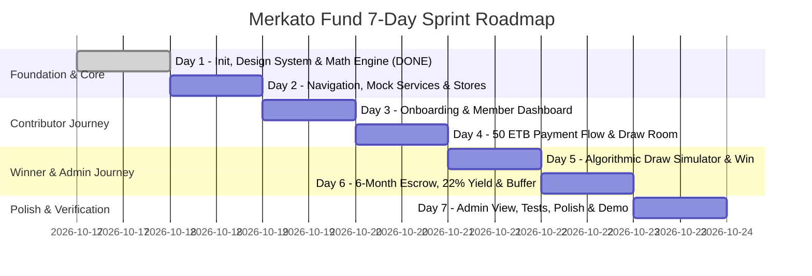

# Merkato Fund — Seven-Day Implementation Plan & Delivery Roadmap

**Project**: Merkato Fund Mobile Application  
**Target Platform**: Android & iOS (React Native + Expo SDK 58 + TypeScript)  
**Timeline**: 7 Calendar Days  
**Author**: Senior Mobile Architect & Product Engineer  
**Date**: October 2026 (Day 1 Implemented & Verified)  

---

## 1. Strategy: Small, Working End-to-End Demo Over Incomplete Breadth

In mobile fintech prototypes, an end-to-end user journey that works reliably across every touchpoint is far more compelling than a wide array of half-baked, broken screens.

### Core Guiding Tenet
> **"One complete, verifiable loop first."**  
> We prioritize a rock-solid, cohesive experience where a user can onboard, make a simulated 50 ETB daily payment via Telebirr, see their draw ticket generated, witness the live algorithmic draw countdown, and inspect the winner's 6-month escrow with real-time 22% interest ticking and buffer status.

---

## 2. Seven-Day Day-by-Day Implementation Roadmap

---

### Day 1: Project Initialization, Design Tokens & Domain Math Engine (STATUS: VERIFIED)
- **Objective**: Establish the Expo project structure, TypeScript configuration, design tokens, and thoroughly tested domain calculation engines.
- **Implemented Deliverables**:
  - Initialized clean Expo project using Expo SDK 58 with Expo Router tabs template (compatible with React 19 and React Native 0.88).
  - Setup TypeScript `tsconfig.json` with strict type checking, path aliases (`@/*`), and `@types/node`.
  - Created accessible design system and theme tokens in `src/theme/tokens.ts` and updated `constants/Colors.ts`.
  - Built reusable accessible UI primitives in `src/components/ui/` (`AppButton`, `Card`, `CurrencyDisplay`, `DemoBadge`, `DisclaimerNotice`, `StatusPill`).
  - Implemented pure domain financial calculation modules:
    - `src/domain/calculations/currency.ts`: ETB currency formatting with prefix, suffix, and compact formats.
    - `src/domain/calculations/interest.ts`: Documented ACT/365 simple interest arithmetic, accrued yield, and net daily flow.
    - `src/domain/calculations/repayment.ts`: Configurable repayment scenarios (500 ETB vs 550 ETB), separate 50 ETB admin fee distinction, estimated payoff duration, and 7,500 ETB / 15-day buffer health calculations.
    - `src/domain/calculations/drawSimulation.ts`: Seeded demonstration draw simulation isolated from financial arithmetic.
  - Automated test suite in `src/domain/calculations/__tests__/calculations.test.ts` (33 unit tests passing via `npm test`).
  - Interactive Day 1 Engine Playground in `app/(tabs)/index.tsx`, Rules Audit in `app/(tabs)/two.tsx`, and Safety Modal in `app/modal.tsx`.
  - Added `AGENTS.md` with project conventions and financial safety boundaries.
    - `src/domain/calculations/draw-algorithm.ts`: Seeded pseudo-random draw algorithm.
  - Setup **Jest test suite** and execute automated unit tests verifying the mathematical engine.

---

### Day 2: Navigation Shell, Mock Services & State Management (STATUS: VERIFIED)
- **Objective**: Build the application backbone, navigation routing, mock services, and Zustand stores.
- **Implemented Deliverables**:
  - Configured Expo Router tab navigation in `app/(tabs)/_layout.tsx`:
    - `app/(tabs)/index.tsx`: Member Dashboard with instant Persona Switcher and live metrics.
    - `app/(tabs)/contribute.tsx`: 50 ETB payment simulation across Telebirr/CBE and synthetic transaction ledger.
    - `app/(tabs)/draw.tsx`: Daily 1M ETB algorithmic draw room, SHA-256 transparency seed, ticket ledger, and live demonstration draw simulator.
    - `app/(tabs)/winner.tsx`: Winner custody experience with 1,000,000 ETB escrow at CBE, 22% yield accrual (ACT/365), daily repayments (500 ETB + 50 ETB fee), and 15-day / 7,500 ETB buffer health monitor.
    - `app/(tabs)/admin.tsx`: Auditor & compliance dashboard with 20,000 member solvency analysis and role-guarding.
    - `app/(tabs)/verify.tsx`: Comprehensive Day 2 developer verification screen proving persona switching, state reactivity, contribution submission, draw execution, winner/admin data, and demo reset.
    - Preserved Day 1 Math Engine (`app/(tabs)/engine.tsx`) and Ambiguities (`app/(tabs)/two.tsx`) as routable reference screens.
  - Core service interfaces and offline mock adapter:
    - `src/services/interfaces/IMerkatoService.ts`: Ports & Adapters contracts.
    - `src/services/mock/mockData.ts`: Authentic Ethiopian seed data for 3 personas (Dawit Haile, Bethlehem Tadesse, Abebe Kebede).
    - `src/services/mock/MockMerkatoService.ts`: In-memory offline repository with deterministic behavior and automatic ticket issuance.
  - Zustand state management:
    - `useUserStore`: Persona switching and profile updates.
    - `useContributionStore`: Daily contribution status and transaction ledger.
    - `useDrawStore`: Draw countdowns, entry tickets, and demonstration draw simulation.
    - `useWinnerStore`: 1,000,000 ETB escrow, repayment installments, and buffer replenishment.
    - `useDemoConfigStore`: Toggleable financial models (500+50 vs 550 flat).
    - `resetAllDemoStores()`: Unified demo reset restoring all 5 stores and mock service to initial state.
  - UI Primitives: `PersonaSelector`, `MetricTile`, `StatusPill` with size/info variants.
  - Automated test suite expanded to **54 passing unit tests** across 19 suites (`src/**/__tests__/**/*.test.ts`).

---

### Day 3: Welcome Onboarding, Persona Selection & Member Dashboard (COMPLETE & VERIFIED)
- **Objective**: Deliver the initial user entry flow, clean persona selection, and the refined Member Dashboard.
- **Deliverables**:
  - **Onboarding Carousel (`app/onboarding.tsx`)**:
    - 3-slide educational walkthrough:
      - Slide 1: "A Different Approach to Equb" (Equb + Draw + Bank Escrow + Capital Markets).
      - Slide 2: "Daily 50 ETB Micro-Contribution Model" (Continuous streak & algorithmic ticket issuance).
      - Slide 3: "Draw, Escrow & Repayment Process" (1M ETB CBE blocked escrow, 22% ACT/365 interest, 500+50 repayment, 7,500 buffer, and reality check post-180 days).
    - Clear Next, Back, Skip to Demo, and Get Started navigation actions.
    - Prominent `DemoBadge` and visible `DisclaimerNotice` on every slide.
  - **Demo Persona Selection Screen (`app/persona-select.tsx`)**:
    - Dedicated entry selection screen for Dawit Haile (Member), Bethlehem Tadesse (Winner), and Abebe Kebede (Admin/Auditor).
    - Explains exact demonstration scope each persona unlocks.
    - Re-hydrates all Zustand stores synchronously via `switchPersona`.
    - No real authentication credentials or live data collected.
    - Quick actions to Enter Dashboard or Replay Onboarding.
  - **Member Dashboard (`app/(tabs)/index.tsx`)**:
    - Ethiopian greeting ("ሰላም / Welcome, Dawit!", "እንኳን ደህና መጡ").
    - Active persona indicator chip and quick inline/modal switcher.
    - Daily 50 ETB Contribution Status (PAID TODAY vs PAYMENT DUE).
    - 7-day visual streak tracker and recent synthetic activity ledger snippet.
    - Tonight's 1,000,000 ETB algorithmic draw card with simulation-only wording and ticket status.
    - Primary quick actions (Contribute, Draw, Winner Escrow, Admin Pool, Replay Onboarding).
  - **Automated Tests (`src/stores/__tests__/stores.test.ts`)**:
    - Expanded test suite to **55 passing unit tests** across 19 suites. Verified `hasCompletedOnboarding`, `setHasCompletedOnboarding`, and `resetOnboarding`.

---

### Day 4: Daily 50 ETB Contribution Flow & Simulated Payment Gateway (COMPLETE & VERIFIED)
- **Objective**: Deliver a complete, deliberate, interactive demo contribution flow for the proposed 50 ETB daily payment.
- **Deliverables**:
  - **Contribution Screen (`app/(tabs)/contribute.tsx`)**:
    - Daily 50 ETB amount and status display (Payment Due vs Paid for Today).
    - Simulated Ethiopian payment channels: Telebirr (USSD push), CBE Birr (Commercial Bank debit), Awash Birr (digital micro-payment).
    - Deliberate review and confirmation modal with demo transaction reference preview (`DEMO-TX-20261017-PREVIEW`).
    - Double-submission guard (`isSubmitting`) preventing rapid multi-taps.
    - Success celebration receipt displaying issued algorithmic draw ticket (`MF-20261017-xxxx`), updated streak (+1), and navigation shortcuts.
    - Duplicate prevention: blocks repeated payments when `paidToday` is true.
    - Historical contribution ledger with deterministic records for active persona.
    - Prominent simulation disclaimers: no real banking integration or fiat currency collection.
  - **Automated Tests (`src/stores/__tests__/stores.test.ts`)**:
    - Expanded test suite to **59 passing unit tests** across 19 suites. Verified single record creation, multi-store synchronization (`paidToday`, streak, wallet balance, draw ticket), duplicate prevention, channel support, and state integrity on failure.

---

### Day 5: Algorithmic Draw Simulator & Interactive Winner Announcement (COMPLETE & VERIFIED)
- **Objective**: Deliver a polished, demonstration-only draw experience and interactive winner announcement with strict eligibility, duplicate prevention, deterministic testing, and multi-store consistency.
- **Deliverables**:
  - **Draw Room Screen (`app/(tabs)/draw.tsx`)**:
    - Prominent "DEMO DRAW — NOT A REAL LOTTERY" notice and model assumptions (20:00:00 EAT draw schedule).
    - Eligible synthetic tickets list with ticket numbers, issuance timestamps, and persona owners.
    - Safe empty state when 0 eligible tickets exist with CTAs to simulate daily contribution or seed a sample ticket.
    - Deliberate review & confirmation modal with pseudo-random seed preview before draw execution.
    - Duplicate prevention: blocks re-execution when draw is completed, offering an explicit "Replay / Reset Draw" action.
    - Celebration winner announcement modal displaying winning ticket number, winner persona profile, illustrative 1M ETB prize, and immediate routing to Winner Hub.
    - Historical draw ledger with past winners and synthetic participant counts.
  - **Winner Screen (`app/(tabs)/winner.tsx`)**:
    - Prominent "SIMULATED WINNER — NO MONEY AWARDED" banner.
    - Today's draw winner banner dynamically synced with `useDrawStore`.
    - Illustrative 1,000,000 ETB blocked escrow at CBE with `DEMO-` prefixed accounts.
    - Evaluator navigation shortcuts ("Return to Draw Room", "Reset Active Draw").
  - **Services & Stores (`MockMerkatoService.ts`, `useDrawStore.ts`)**:
    - Strict eligibility check: zero tickets produces an error (no synthetic winner fallback).
    - Prevents duplicate draws on completed instances.
    - Multi-store winner sync: winner's 1M ETB escrow and buffer automatically initialize so the winner screen immediately reflects the result.
    - Deterministic demo seed injection support for automated tests.
  - **Automated Tests (`src/services/__tests__/mockService.test.ts`, `src/stores/__tests__/stores.test.ts`)**:
    - Expanded test suite to **67 passing unit tests** across 19 suites covering all 10 prompt criteria:
      1. Zero eligible tickets produces no winner / rejects execution.
      2. Valid eligible ticket is selected.
      3. Selected winner strictly matches the ticket owner.
      4. Duplicate draw execution blocked without explicit reset.
      5. Draw result remains consistent across stores and screens.
      6. Reset clears draw and winner state cleanly.
      7. Persona switching preserves draw result and does not overwrite it.
      8. Deterministic test seed produces predictable selection.
      9. Ineligible tickets are never selected.
      10. Errors do not corrupt or leave partial winner state.

---

### Day 6: Six-Month Escrow, Interest Accrual, Repayment & Buffer Simulator (COMPLETE & VERIFIED)
- **Objective**: Deliver a transparent, interactive financial simulation of the winner's 1,000,000 ETB escrow account, 22% ACT/365 interest accrual, dual-scenario repayment schedule, 15-day rolling buffer, and mathematical cash flow reality check.
- **Deliverables**:
  - **Six-Month Interactive Timeline Controller (`app/(tabs)/winner.tsx`)**:
    - Clamped simulation day controller (Day 0 to Day 180) with step controls (`-15d`, `-1d`, `+1d`, `+15d`) and key checkpoint presets (Day 0, Day 15, Day 30, Day 45, Day 90, Day 135, Day 180).
    - Synchronizes all financial figures dynamically without mutating user contribution history or adding unwanted ledger transactions.
  - **Escrow Account Breakdown**:
    - Illustrative opening balance: 1,000,000 ETB principal held under Commercial Bank of Ethiopia (CBE) custody with `DEMO-` prefix.
    - Accrued interest calculated via ACT/365 simple interest (`calculateAccruedInterest`).
    - Clear segregation between blocked principal and accrued interest; explicit notice that interest is locked in bank custody and non-withdrawable during the 180-day period.
    - Explicitly labels annual rate (22%) and bank custody as unverified model assumptions.
  - **Repayment Scenario Inspector (Scenario A vs Scenario B)**:
    - Interactive switch between Scenario A (500 ETB principal + 50 ETB fee = 550 ETB/day) and Scenario B (550 ETB flat principal, 0 fee).
    - Cumulative principal repaid and administrative fees separated rigorously (fees do NOT reduce principal).
    - Post-escrow payoff horizon: highlights that at Day 180 unlock, ~910,000 ETB (Scenario A) or 901,000 ETB (Scenario B) of principal debt remains unpaid, requiring 1,820 or 1,639 additional daily payments (~5 more years) to fully repay.
  - **15-Day Buffer Simulator (`calculateBufferStatus`, `calculateBufferReplenishment`)**:
    - 7,500 ETB buffer balance monitor tracking daily burn over a 15-day cycle.
    - Cumulative replenishment requirement tracking: `completedCycles * 7,500 ETB`.
    - Documents explicitly that the source material lacks a defined funding rule for who pays for buffer replenishments (`unresolved_funding_rule`).
  - **Financial Reality Check & Cash Flow Solvency Section (`calculateRealityCheck`)**:
    - Visual cash flow comparison: +602.74 ETB daily interest yield vs -550.00 ETB daily repayment = +52.74 ETB/day surplus.
    - 15-day cash flow contradiction: +791.10 ETB accumulated interest surplus vs 7,500 ETB buffer replenishment requirement = **-6,708.90 ETB net deficit per 15-day cycle** if the buffer is expected to be funded from interest.
  - **Automated Tests (`src/domain/calculations/__tests__/calculations.test.ts`, `src/stores/__tests__/stores.test.ts`)**:
    - Expanded test suite to **76 passing unit tests** across 20 suites covering all 11 prompt criteria:
      1. Correct daily simple interest calculation (ACT/365).
      2. Cumulative interest at Day 0, Day 15, Day 90, and Day 180.
      3. Remaining principal under Scenario A.
      4. Remaining principal under Scenario B.
      5. Strict separation of principal, fees, and interest.
      6. Buffer replenishment schedule accounting.
      7. Explicit handling of undefined buffer funding rules.
      8. Clamping simulation day to [0, 180] range.
      9. Changing simulation day does not mutate contribution transactions.
      10. Reset restores intended simulation state.
      11. Financial calculations remain consistent across UI and domain modules.

---

### Day 7: Admin Preview, Automated Testing, Polish & Demo Handover
- **Objective**: Add optional admin view, run test suite, polish UI edge cases, and finalize deliverables.
- **Deliverables**:
  - **Administrator View (`app/admin/index.tsx`)**:
    - Pool health metrics (Total contributors, daily inflow, prize allocation).
    - Manual draw trigger and RNG audit log.
    - Role gate (only visible when Admin persona is selected).
  - **Demo Sandbox Controls**:
    - Floating / Profile Drawer allowing demo evaluators to toggle financial parameters, reset state, or accelerate draw countdowns.
  - **Automated Test Suite**:
    - Run all Jest unit tests (`calculations.test.ts`, `mock-services.test.ts`).
  - **Cross-Device UI Polish**:
    - Responsive layout verification for small and large screens.
    - Light / Dark theme contrast checks.
    - Empty states, network error simulations, and loading skeleton states.

---

## 3. Testing Strategy & Quality Assurance Matrix

| Test Level | Scope / Target | Tools | Key Assertions |
|---|---|---|---|
| **Unit Tests** | `src/domain/calculations/interest.ts` | Jest | $\frac{1,000,000 \times 0.22}{365} = 602.7397$ ETB/day. 180-day interest yield $= 108,493.15$ ETB. |
| **Unit Tests** | `src/domain/calculations/amortization.ts` | Jest | 500 ETB $\times 30 = 15,000$ ETB/mo. 550 ETB $\times 30 = 16,500$ ETB/mo. Daily net yield with 22% offset is $+52.74$ ETB. |
| **Unit Tests** | `src/domain/calculations/draw-algorithm.ts` | Jest | Seed-based RNG produces deterministic results, ticket in range $[1, N]$. |
| **Service Tests** | `src/services/mock/*` | Jest | Mock services fulfill interfaces, handle latency simulations, and emit expected types. |
| **Component Tests** | Core UI primitives (`Button`, `Card`, `Badge`) | React Native Testing Library | Render accessible touch targets, display active/disabled states, format ETB properly. |
| **Manual QA** | End-to-End Demo Journey | Expo Go / Simulator | Flawless persona switching, payment simulation, draw triggering, and escrow inspection without crashes. |
